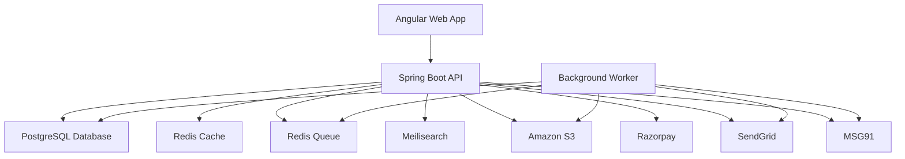
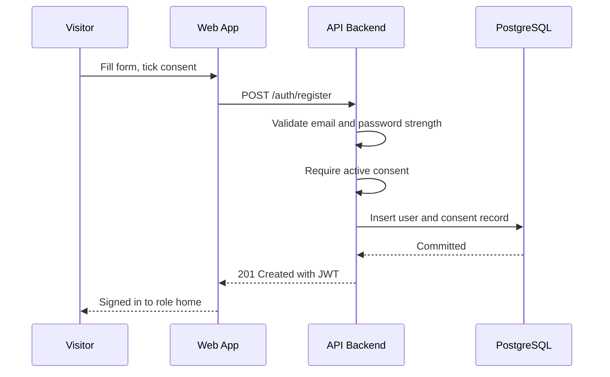
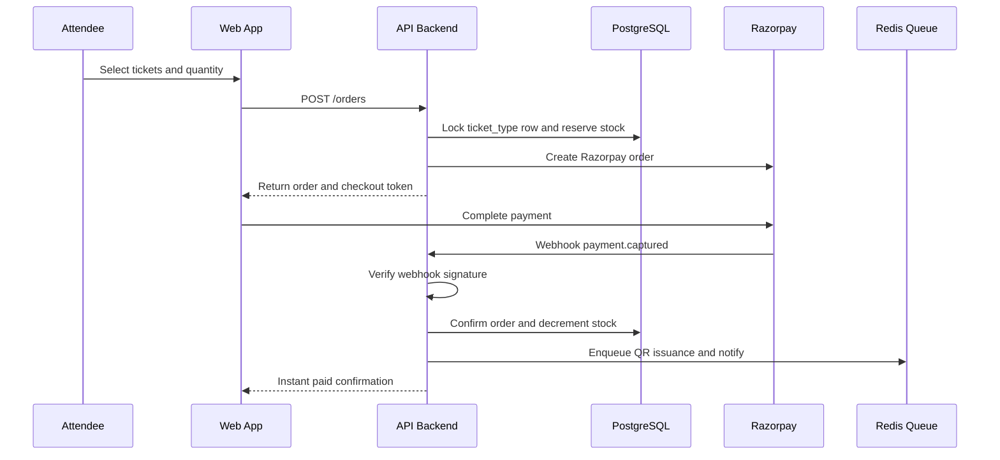
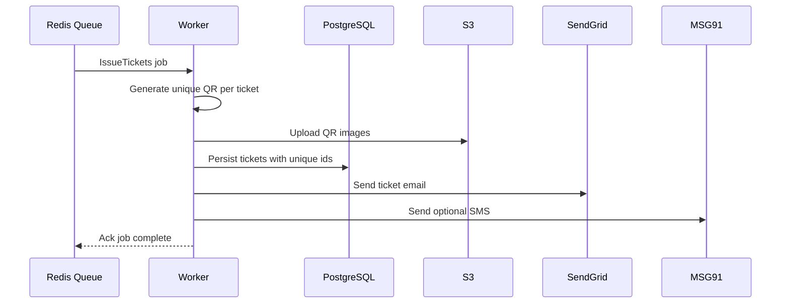
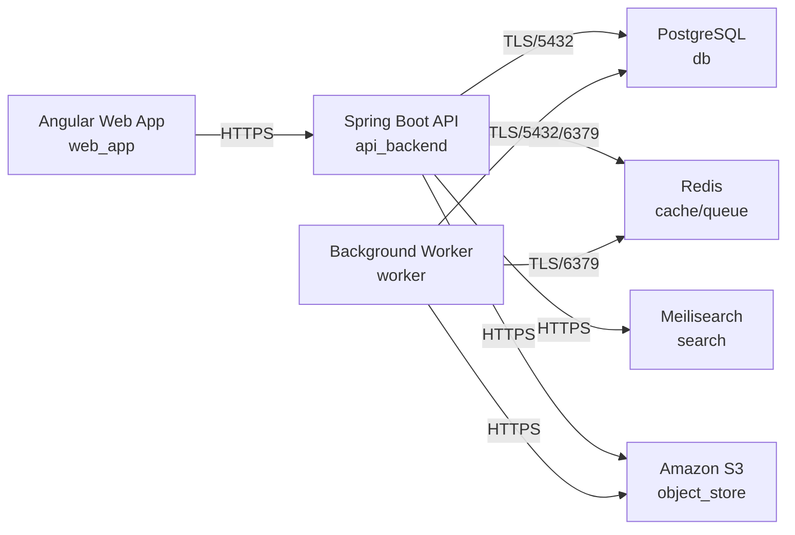

# Architecture

> Maintained by QuorQ AI SDLC. Text between `sdlc:auto` markers is regenerated; anything outside them is yours and is kept.

<!-- sdlc:auto:start narrative -->
## Overview

### ARCH-000 · approved · source: architecture:summary

eventbooking2 is a lightweight general-admission event booking web app for the Indian market: Angular 22 frontend, Spring Boot 4.1 backend, PostgreSQL 16, all hosted on AWS ap-south-1 (Mumbai) for DPDP/RBI data-localisation posture. Architecture is approved, version 1.

Attendees and organizers self-register with explicit, unbundled DPDP consent captured at signup and withdrawable from settings. Organizers create events and general-admission ticket types; attendees browse/search via Meilisearch by city, date and category, book and pay online via Razorpay, and receive unique QR-coded tickets stored in S3, viewable in a 'my tickets' view. PostgreSQL transactional guarantees plus Redis coordination prevent overselling. Redis-backed background jobs issue QR tickets and send SendGrid email / MSG91 SMS notifications for instant paid confirmation. Audit logging retains ICT logs for 180 days to meet CERT-In expectations. Stack was built against the product owner's approved choices.

- ⚠ Architecture input does not map components or critical paths to specific requirement IDs (US-001..US-014); requirements-to-architecture traceability needs to be confirmed against the requirements phase input directly.
- ⚠ No approval date or approver name given for the v1 architecture sign-off.

### ARCH-COMP-WEB · approved · source: architecture:components.web_app

Angular Web App (Angular 22) is the responsive SPA covering registration, consent, event discovery, booking, payment handoff and the my-tickets view.

Runs on desktop and mobile browsers. Deployed as a static build on S3 + CloudFront in ap-south-1. Uses Angular's built-in forms and routing for validation and empty-state UX.

### ARCH-COMP-API · approved · source: architecture:components.api_backend

Spring Boot API is the core business-logic service: auth, consent records, event/ticket-type management, discovery, order and payment orchestration, QR ticket issuance, access control and audit logging.

Built on Spring Boot 4.1, deployed as an ECS Fargate container on Java 21 in ap-south-1. Integrates with RDS PostgreSQL, Redis, S3 and the Razorpay/SendGrid/MSG91 SDKs. Spring Security and transaction management back the no-oversell booking path, consent handling, role-based access and audit logging.

### ARCH-COMP-WORKER · approved · source: architecture:components.worker

Background Worker consumes Redis queue jobs to generate QR tickets, upload them to S3, and send booking confirmation/reminder email and SMS off the request path.

Built on Spring Boot 4.1, deployed as a separate ECS Fargate container on Java 21 in ap-south-1. Keeps QR issuance and notification work asynchronous so the booking/payment request path stays fast.

### ARCH-COMP-DB · approved · source: architecture:components.db

PostgreSQL 16 is the system of record for users, consent, events, ticket types, orders, tickets, payments and audit logs.

Provides strong transactions that prevent overselling and double-use of tickets. Hosted as Amazon RDS for PostgreSQL 16, encrypted at rest, in ap-south-1 for data residency.

### ARCH-COMP-CACHE · approved · source: architecture:components.cache

Redis Cache (Redis 7) caches hot event-listing data and coordinates ticket-quantity counters under sudden demand so the site stays fast and does not oversell.

Deployed via ElastiCache for Redis 7 (redis:7-alpine) in ap-south-1. Works alongside PostgreSQL row locking in the booking critical path as a demand-surge counter.

### ARCH-COMP-QUEUE · approved · source: architecture:components.queue

Redis Queue (Redis 7) holds background jobs for QR issuance, email and SMS so buyers get an instant paid response.

Shares the ElastiCache for Redis 7 deployment in ap-south-1 with the cache component. Decouples ticket issuance/notification from the synchronous payment confirmation path.

### ARCH-COMP-SEARCH · approved · source: architecture:components.search

Meilisearch (v1.10.3) provides a fast, typo-tolerant index of events filterable by city, date and category.

Deployed as a getmeili/meilisearch:v1.10.3 container on ECS in ap-south-1. Backs the GET /events/search endpoint.

### ARCH-COMP-S3 · approved · source: architecture:components.object_store

Amazon S3 (ap-south-1) provides durable storage in Mumbai for event posters and generated QR-ticket images served to browsers.

Encrypted S3 bucket in ap-south-1, satisfying data-residency posture for stored media assets.

### ARCH-COMP-PAYMENTS · approved · source: architecture:components.payments

Razorpay handles online payments via UPI and Indian cards, with settlement kept in India.

Notifies the backend of payment status via a webhook (POST /payments/webhook), which the backend verifies before confirming a booking.

### ARCH-COMP-EMAIL · approved · source: architecture:components.email

SendGrid delivers transactional email: QR tickets, confirmations and updates.

Invoked by the Background Worker as part of asynchronous ticket issuance/notification jobs.

### ARCH-COMP-SMS · approved · source: architecture:components.sms

MSG91 provides optional DLT-registered Indian SMS alerts for booking and event updates.

Invoked by the Background Worker alongside SendGrid email as part of the notification job; marked optional in the architecture.

### ARCH-CP-CONSENT · approved · source: architecture:critical_paths.signup_consent

Signup with DPDP consent: a visitor registers as attendee or organizer; the system validates email/password and requires an actively ticked, unbundled consent control before creating the account.

The backend validates email uniqueness and password strength, requires explicit unbundled consent, creates the account, and stores an immutable consent record (purposes, timestamp, notice version) before signing the user in. Implemented via POST /auth/register and the consent_records entity; withdrawal is handled by POST /consent/withdraw through a flow no harder than granting.

- ⚠ No explicit requirement ID linked in the architecture input for this critical path.

### ARCH-CP-BOOKING · approved · source: architecture:critical_paths.book_and_pay

Book and pay without overselling: attendee selects ticket types/quantities; stock is reserved transactionally and only confirmed once payment is verified via webhook.

The backend reserves stock inside a PostgreSQL transaction using row locking plus a Redis counter, creates a Razorpay order, and confirms the booking (decrementing committed stock, enqueuing ticket issuance) only when the Razorpay webhook verifies successful payment. Failed or cancelled payments release the reservation. Implemented via POST /orders and POST /payments/webhook against the orders, order_items and payments entities.

- ⚠ No explicit requirement ID linked in the architecture input for this critical path.

### ARCH-CP-QR · approved · source: architecture:critical_paths.qr_issuance

QR ticket issuance and notification: after payment confirmation, a background worker generates and delivers the attendee's QR ticket asynchronously.

The worker consumes the issuance job from the Redis queue, generates a unique QR code per ticket, uploads the image to S3 in Mumbai, persists the ticket with a unique identifier, and sends the attendee their ticket via SendGrid email and optional MSG91 SMS. Tickets are viewable via GET /me/tickets and GET /me/tickets/{id}.

- ⚠ No explicit requirement ID linked in the architecture input for this critical path.

### ARCH-DATA-MODEL · approved · source: architecture:entities

Core data model spans users/consent, events/ticket types, orders/payments/tickets, and audit logs, all stored in PostgreSQL.

Entities: users(id, email, password_hash, role, full_name, phone, created_at); organizer_profiles(id, user_id, organization_name, contact_details); consent_records(id, user_id, purposes, notice_version, consent_given, granted_at, withdrawn_at); events(id, organizer_id, title, venue, city, category, description, starts_at, poster_url, status, created_at); ticket_types(id, event_id, name, price_inr, quantity_total, quantity_sold); orders(id, attendee_id, event_id, status, total_amount_inr, razorpay_order_id, created_at); order_items(id, order_id, ticket_type_id, quantity, unit_price_inr); tickets(id, order_id, ticket_type_id, qr_code_id, qr_image_url, status, issued_at); payments(id, order_id, razorpay_payment_id, amount_inr, status, created_at); audit_logs(id, actor_user_id, action, entity, entity_id, ip_address, created_at).

### ARCH-API-SURFACE · approved · source: architecture:endpoints

API surface covers auth/consent, event and ticket-type management, discovery/search, ordering/payment, and the attendee's ticket views.

POST /auth/register - register attendee/organizer with validated email/password and required DPDP consent, stores consent record, signs in. POST /auth/login - authenticate and return JWT, generic error on failure. POST /auth/logout - end session. POST /consent/withdraw - record consent withdrawal with timestamp. POST /events - organizer creates event with validated fields. PUT /events/{id} - organizer updates own event, reflected on public listing. POST /events/{id}/ticket-types - organizer defines a general-admission ticket type (name, INR price, quantity). GET /organizer/events - organizer dashboard list with status and sold-vs-available counts. GET /events/search - browse/search via Meilisearch by city/date/category with typo tolerance and empty-state handling. GET /events/{id} - public event detail, ticket types marked sold-out where exhausted. POST /orders - create order for selected ticket types/quantities, reserve stock, create Razorpay order. POST /payments/webhook - verify Razorpay signature, confirm booking, decrement stock, enqueue ticket issuance. GET /me/tickets - attendee's own tickets, upcoming vs past, with QR images. GET /me/tickets/{id} - view a single owned ticket with QR code and event details.

### ARCH-DEPLOYMENT · approved · source: architecture:deployment_nodes

All components are deployed in AWS ap-south-1 (Mumbai) for DPDP/RBI data-localisation posture.

Angular Web App -> static build on S3 + CloudFront. Spring Boot API -> ECS Fargate container, Java 21. Background Worker -> ECS Fargate container, Java 21. PostgreSQL -> Amazon RDS for PostgreSQL 16, encrypted at rest. Redis (cache + queue) -> ElastiCache for Redis 7 (redis:7-alpine). Meilisearch -> getmeili/meilisearch:v1.10.3 container on ECS. Amazon S3 -> encrypted bucket. All nodes located in ap-south-1.

### ARCH-TECH-FRONTEND · approved · source: architecture:tech_decisions.frontend

Frontend stack decision: Angular 22, chosen over React and Vue, as the product owner's approved stack.

Delivers the responsive SPA (register, consent, search, event detail, booking, my-tickets) using Angular's built-in forms and routing to cover validation and empty-state UX across desktop and mobile browsers.

### ARCH-TECH-BACKEND · approved · source: architecture:tech_decisions.backend

Backend stack decision: Spring Boot 4.1, chosen over Node.js/NestJS and Django, as the product owner's approved stack.

Spring's transaction management and Spring Security back the no-oversell booking path, consent records, role-based access and audit logging, and integrate cleanly with RDS, Redis, S3 and the Razorpay/SendGrid/MSG91 SDKs.

### ARCH-TECH-DB · approved · source: architecture:tech_decisions.database

Database stack decision: PostgreSQL 16, chosen over MySQL and MongoDB, as the product owner's approved stack.

Row-level locking and ACID transactions guarantee stock is never oversold and each QR id is unique; accurate storage of orders and payments; hosted on RDS in Mumbai for residency.

### ARCH-TECH-CLOUD · approved · source: architecture:tech_decisions.cloud

Cloud provider decision: AWS, chosen over Azure and GCP, as the product owner's approved stack.

The Mumbai (ap-south-1) region keeps storage, database and backups inside India for DPDP/RBI posture, offers CloudWatch 180-day log retention for CERT-In, and hosts Razorpay-adjacent workloads comfortably.
<!-- sdlc:auto:end narrative -->

<!-- sdlc:auto:start building-blocks -->
## Building Block View

| ID | Name | Technology | Responsibility | Depends on |
|---|---|---|---|---|
| web_app | Angular Web App | Angular 22 | Responsive SPA for registration, consent, event discovery, booking, payment handoff and the my-tickets view on desktop and mobile browsers | api_backend |
| api_backend | Spring Boot API | Spring Boot 4.1 | Core business logic: auth, consent records, event and ticket-type management, discovery, order and payment orchestration, QR ticket issuance, access control and audit logging | db, cache, queue, search, object_store, payments, email, sms |
| worker | Background Worker | Spring Boot 4.1 | Consumes Redis queue jobs to generate QR tickets, upload them to S3, and send booking confirmation / reminder email and SMS off the request path | db, queue, object_store, email, sms |
| db | PostgreSQL Database | PostgreSQL 16 | System of record for users, consent, events, ticket types, orders, tickets, payments and audit logs with strong transactions that prevent overselling and double-use | — |
| cache | Redis Cache | Redis 7 | Caches hot event listing data and coordinates ticket-quantity counters under sudden demand so the site stays fast and does not oversell | — |
| queue | Redis Queue | Redis 7 | Holds background jobs for QR issuance, email and SMS so buyers get an instant paid response | — |
| search | Meilisearch | Meilisearch v1.10.3 | Fast, typo-tolerant index of events filterable by city, date and category | — |
| object_store | Amazon S3 | Amazon S3 (ap-south-1) | Durable storage in Mumbai for event posters and generated QR-ticket images served to browsers | — |
| payments | Razorpay | Razorpay | Online payments via UPI and Indian cards with settlement kept in India; notifies the backend of payment status via webhook | — |
| email | SendGrid | SendGrid | Transactional email delivery of QR tickets, confirmations and updates | — |
| sms | MSG91 | MSG91 | Optional DLT-registered Indian SMS alerts for booking and event updates | — |

<!-- sdlc:auto:end building-blocks -->

<!-- sdlc:auto:start runtime -->
## Runtime View

### Signup with DPDP consent

A visitor registers as attendee or organizer; the backend validates email uniqueness and password strength, requires an actively ticked unbundled consent control, creates the account, and stores an immutable consent record (purposes, timestamp, notice version) before signing the user in.

- **Components:** web_app, api_backend, db
- **Modules:** AuthController, RegistrationService, ConsentService, PasswordPolicyValidator
- **Key functions:** register(RegistrationRequest), validatePassword(raw), assertEmailUnique(email), recordConsent(userId, purposes, noticeVersion), issueJwt(user)

### Book and pay without overselling

Attendee selects ticket types and quantities; the backend reserves stock inside a PostgreSQL transaction using row locking and a Redis counter, creates a Razorpay order, and only confirms, decrements committed stock and enqueues ticket issuance when the payment webhook verifies success. Failed or cancelled payments release the reservation.

- **Components:** web_app, api_backend, db, cache, queue, payments
- **Modules:** BookingController, OrderService, InventoryService, PaymentService, RazorpayWebhookController
- **Key functions:** createOrder(eventId, items), reserveStock(ticketTypeId, qty), createRazorpayOrder(amount), handleWebhook(signature, payload), confirmBooking(orderId), releaseReservation(orderId)

### QR ticket issuance and notification

The worker consumes the issuance job, generates a unique QR code per ticket, uploads the image to S3 in Mumbai, persists the ticket with a unique identifier, and sends the attendee their ticket via SendGrid email and optional MSG91 SMS.

- **Components:** worker, db, queue, object_store, email, sms
- **Modules:** TicketIssuanceJob, QrGenerator, S3Uploader, NotificationService
- **Key functions:** process(IssueTicketsJob), generateQr(ticketUuid), uploadQrImage(ticketUuid, png), sendTicketEmail(order), sendTicketSms(order)

<!-- sdlc:auto:end runtime -->

<!-- sdlc:auto:start deployment-view -->
## Deployment View

| Name | Service | Runtime | Scaling | Environment |
|---|---|---|---|---|
| Angular Web App | web_app | Static build on S3 + CloudFront (ap-south-1) | CDN edge | dev |
| Spring Boot API | api_backend | ECS Fargate container, Java 21 (ap-south-1) | 1-2 tasks (dev) | dev |
| Background Worker | worker | ECS Fargate container, Java 21 (ap-south-1) | 1 task (dev) | dev |
| PostgreSQL | db | Amazon RDS for PostgreSQL 16, encrypted at rest (ap-south-1) | single instance + automated backups in India | dev |
| Redis | cache/queue | ElastiCache for Redis 7 / redis:7-alpine (ap-south-1) | single node (dev) | dev |
| Meilisearch | search | getmeili/meilisearch:v1.10.3 container on ECS (ap-south-1) | single node (dev) | dev |
| Amazon S3 | object_store | S3 bucket, encrypted (ap-south-1) | managed | dev |

| Source | Target | Protocol |
|---|---|---|
| Angular Web App | Spring Boot API | HTTPS |
| Spring Boot API | PostgreSQL | TLS/5432 |
| Spring Boot API | Redis | TLS/6379 |
| Spring Boot API | Meilisearch | HTTPS |
| Spring Boot API | Amazon S3 | HTTPS |
| Background Worker | Redis | TLS/6379 |
| Background Worker | PostgreSQL | TLS/5432 |
| Background Worker | Amazon S3 | HTTPS |

<!-- sdlc:auto:end deployment-view -->

<!-- sdlc:auto:start decisions -->
## Architecture Decisions

| Layer | Choice | ADR |
|---|---|---|
| Frontend | Angular 22 | [ADR-0001](adr/frontend.md) |
| Backend | Spring Boot 4.1 | [ADR-0002](adr/backend.md) |
| Database | PostgreSQL 16 | [ADR-0003](adr/database.md) |
| Cloud | AWS | [ADR-0004](adr/cloud.md) |
<!-- sdlc:auto:end decisions -->

<!-- sdlc:auto:start links -->
## Related Documents

- [Data Model](data-model.md)
- [API Specification](api/openapi.yaml)
- [Architecture Decision Records](adr/README.md)
<!-- sdlc:auto:end links -->
