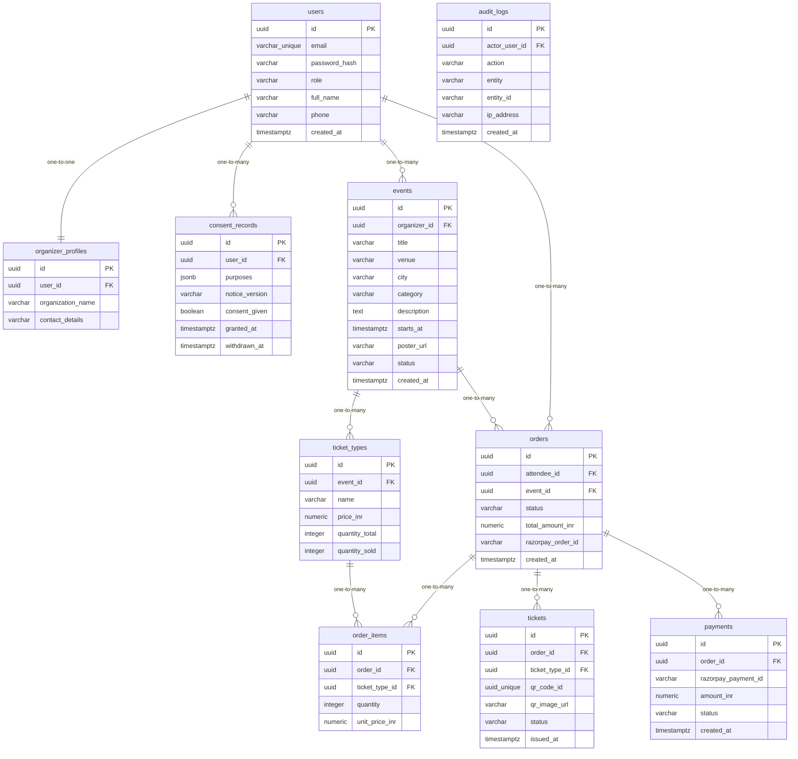

# Data Model

<!-- sdlc:auto:start entities -->
### users

| Field | Type | PK | FK | Nullable |
|---|---|---|---|---|
| id | uuid | True | — | False |
| email | varchar unique | False | — | False |
| password_hash | varchar | False | — | False |
| role | varchar | False | — | False |
| full_name | varchar | False | — | False |
| phone | varchar | False | — | True |
| created_at | timestamptz | False | — | False |

### organizer_profiles

| Field | Type | PK | FK | Nullable |
|---|---|---|---|---|
| id | uuid | True | — | False |
| user_id | uuid | False | users.id | False |
| organization_name | varchar | False | — | False |
| contact_details | varchar | False | — | True |

### consent_records

| Field | Type | PK | FK | Nullable |
|---|---|---|---|---|
| id | uuid | True | — | False |
| user_id | uuid | False | users.id | False |
| purposes | jsonb | False | — | False |
| notice_version | varchar | False | — | False |
| consent_given | boolean | False | — | False |
| granted_at | timestamptz | False | — | False |
| withdrawn_at | timestamptz | False | — | True |

### events

| Field | Type | PK | FK | Nullable |
|---|---|---|---|---|
| id | uuid | True | — | False |
| organizer_id | uuid | False | users.id | False |
| title | varchar | False | — | False |
| venue | varchar | False | — | False |
| city | varchar | False | — | False |
| category | varchar | False | — | False |
| description | text | False | — | False |
| starts_at | timestamptz | False | — | False |
| poster_url | varchar | False | — | True |
| status | varchar | False | — | False |
| created_at | timestamptz | False | — | False |

### ticket_types

| Field | Type | PK | FK | Nullable |
|---|---|---|---|---|
| id | uuid | True | — | False |
| event_id | uuid | False | events.id | False |
| name | varchar | False | — | False |
| price_inr | numeric | False | — | False |
| quantity_total | integer | False | — | False |
| quantity_sold | integer | False | — | False |

### orders

| Field | Type | PK | FK | Nullable |
|---|---|---|---|---|
| id | uuid | True | — | False |
| attendee_id | uuid | False | users.id | False |
| event_id | uuid | False | events.id | False |
| status | varchar | False | — | False |
| total_amount_inr | numeric | False | — | False |
| razorpay_order_id | varchar | False | — | True |
| created_at | timestamptz | False | — | False |

### order_items

| Field | Type | PK | FK | Nullable |
|---|---|---|---|---|
| id | uuid | True | — | False |
| order_id | uuid | False | orders.id | False |
| ticket_type_id | uuid | False | ticket_types.id | False |
| quantity | integer | False | — | False |
| unit_price_inr | numeric | False | — | False |

### tickets

| Field | Type | PK | FK | Nullable |
|---|---|---|---|---|
| id | uuid | True | — | False |
| order_id | uuid | False | orders.id | False |
| ticket_type_id | uuid | False | ticket_types.id | False |
| qr_code_id | uuid unique | False | — | False |
| qr_image_url | varchar | False | — | True |
| status | varchar | False | — | False |
| issued_at | timestamptz | False | — | True |

### payments

| Field | Type | PK | FK | Nullable |
|---|---|---|---|---|
| id | uuid | True | — | False |
| order_id | uuid | False | orders.id | False |
| razorpay_payment_id | varchar | False | — | True |
| amount_inr | numeric | False | — | False |
| status | varchar | False | — | False |
| created_at | timestamptz | False | — | False |

### audit_logs

| Field | Type | PK | FK | Nullable |
|---|---|---|---|---|
| id | uuid | True | — | False |
| actor_user_id | uuid | False | users.id | True |
| action | varchar | False | — | False |
| entity | varchar | False | — | False |
| entity_id | varchar | False | — | True |
| ip_address | varchar | False | — | True |
| created_at | timestamptz | False | — | False |
<!-- sdlc:auto:end entities -->

<!-- sdlc:auto:start relationships -->
| Source | Target | Type |
|---|---|---|
| users | organizer_profiles | one-to-one |
| users | consent_records | one-to-many |
| users | events | one-to-many |
| events | ticket_types | one-to-many |
| users | orders | one-to-many |
| events | orders | one-to-many |
| orders | order_items | one-to-many |
| ticket_types | order_items | one-to-many |
| orders | tickets | one-to-many |
| orders | payments | one-to-many |
<!-- sdlc:auto:end relationships -->

<!-- sdlc:auto:start er-diagram -->

<!-- sdlc:auto:end er-diagram -->
