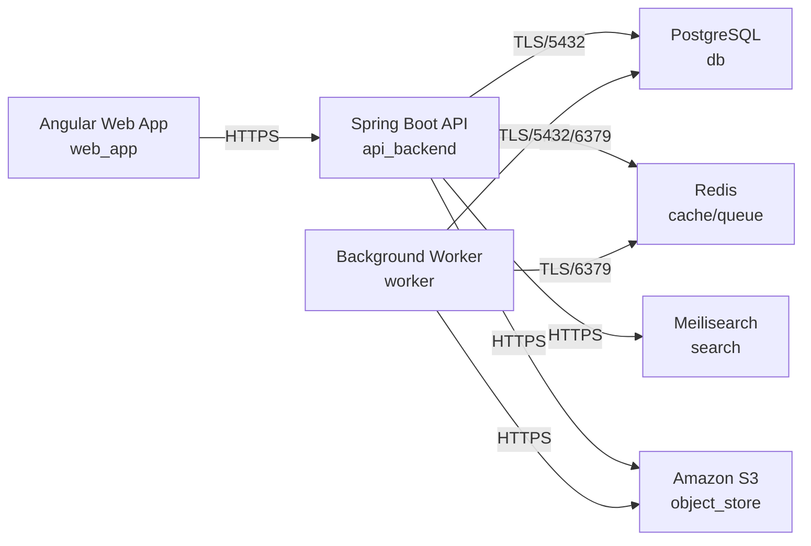

# Deployment Guide

> Maintained by QuorQ AI SDLC. Text between `sdlc:auto` markers is regenerated; anything outside them is yours and is kept.

<!-- sdlc:auto:start how-it-deploys -->
Pushes to `main` run `.github/workflows/deploy.yml`, which builds the API image (if there is a backend) and deploys the SPA to AWS Amplify. Commits touching only `docs/sdlc/**` don't deploy. Deployments can also be started from the platform's Deployment tab.
<!-- sdlc:auto:end how-it-deploys -->

<!-- sdlc:auto:start environments -->
| Name | Service | Runtime | Scaling | Environment |
|---|---|---|---|---|
| Angular Web App | web_app | Static build on S3 + CloudFront (ap-south-1) | CDN edge | dev |
| Spring Boot API | api_backend | ECS Fargate container, Java 21 (ap-south-1) | 1-2 tasks (dev) | dev |
| Background Worker | worker | ECS Fargate container, Java 21 (ap-south-1) | 1 task (dev) | dev |
| PostgreSQL | db | Amazon RDS for PostgreSQL 16, encrypted at rest (ap-south-1) | single instance + automated backups in India | dev |
| Redis | cache/queue | ElastiCache for Redis 7 / redis:7-alpine (ap-south-1) | single node (dev) | dev |
| Meilisearch | search | getmeili/meilisearch:v1.10.3 container on ECS (ap-south-1) | single node (dev) | dev |
| Amazon S3 | object_store | S3 bucket, encrypted (ap-south-1) | managed | dev |
<!-- sdlc:auto:end environments -->

<!-- sdlc:auto:start live -->
**Frontend URL:** https://p23d7ab63ec7d.dshared.amplifyapp.local

**Backend URL:** https://23d7ab63ec7d.local.awsapprunner.local

**Database:** PostgreSQL · aisdlc_23d7ab63ec7d

**Version:** 88c1f0dd60a9

**Commit:** `88c1f0d`

**Finished:** 2026-11-04
<!-- sdlc:auto:end live -->

<!-- sdlc:auto:start topology -->

<!-- sdlc:auto:end topology -->
